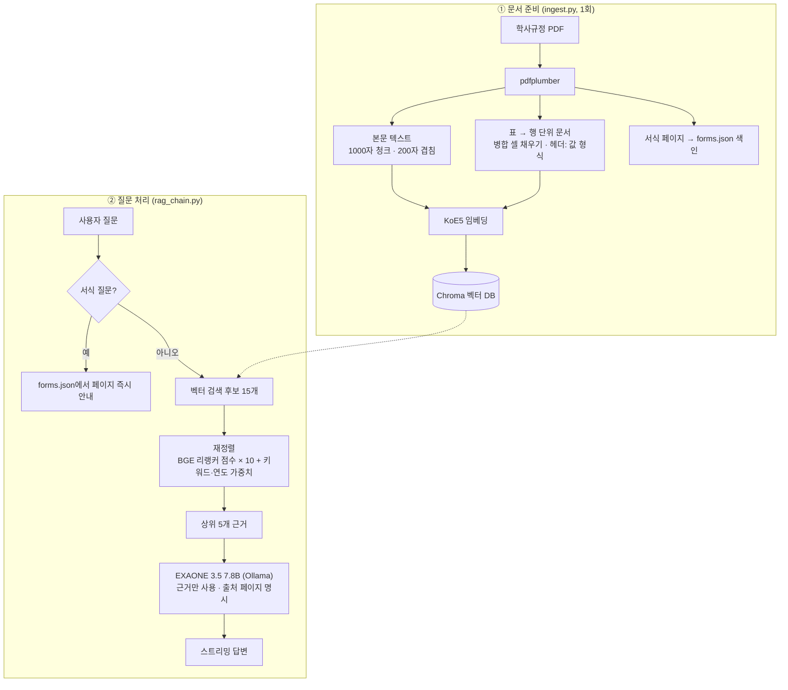

# 학사규정 RAG 챗봇

> 100페이지가 넘는 **대학 학사규정 PDF**를 근거로, 졸업 요건·휴학·수강 같은 질문에 **출처 페이지와 함께** 답하는 챗봇입니다.
> 외부 API 없이 **로컬 LLM**으로 동작합니다.


| 구분 | 내용 |
|---|---|
| 형태 | 캡스톤 디자인 프로젝트 <!-- ✏️ 개인/팀 여부와 본인 담당을 적어 주세요. 예) 팀 3명 · 본인: RAG 파이프라인 전체 --> |
| 기간 | 2026 <!-- ✏️ 예) 2026.03 ~ 2026.06 --> |
| 데이터 | 학사규정 PDF 102쪽 (규정 79쪽 + 서식 17종) → 검색 단위 709개 |

<!-- 📸 데모: 질문 → 답변 → 출처 펼치기 화면 GIF를 여기에 추가하세요. -->

---

## 📌 왜 만들었나요?

학사규정은 분량이 많고 표와 서식이 섞여 있어서, "졸업하려면 몇 학점이 필요한지", "휴학원 서식은 어디 있는지" 같은 답을 찾기 어렵습니다.
이 챗봇은 질문을 받으면 규정에서 관련 부분을 찾아 **근거 안에서만** 답하고, 답변 끝에 **출처 페이지**를 붙여 사용자가 원문을 직접 확인할 수 있게 합니다.

## ✨ 주요 기능

- **근거 기반 답변 + 출처 표시**: 검색된 규정 내용만 사용하도록 프롬프트로 제한하고, "출처: 학사규정 N페이지"를 펼쳐 볼 수 있게 표시
- **스트리밍 응답**: 답변이 생성되는 대로 바로 화면에 표시
- **서식 위치 바로 찾기**: "휴학원 서식 어디 있어?" 같은 질문은 LLM을 거치지 않고 미리 만든 서식 색인(`forms.json`)에서 바로 페이지를 안내
- **자주 묻는 질문 버튼 · 카테고리**: 수강 / 졸업 / 휴학·복학 / 서식 찾기
- **입학년도 확인**: 학점 질문은 입학년도·학과에 따라 답이 달라서 먼저 되묻도록 설계

## 🏗 동작 구조



## 🔍 핵심 구현

**1. 표를 행 단위로 쪼개 저장** — `ingest.py`
- 학점표처럼 중요한 정보가 표에 많은데, 일반 청크 분할을 하면 표가 중간에 잘려 "어느 열의 값인지"를 잃어버립니다.
- 표의 각 행을 `헤더: 값 | 헤더: 값` 형식의 독립 문서로 만들고, 병합 셀(빈 칸)은 위 행 값으로 채워서 행 하나만 검색돼도 의미가 통하게 했습니다.

**2. 의미 검색 + 재정렬 (하이브리드)** — `src/rag_chain.py`
- 한국어 임베딩 **KoE5**로 후보 15개를 넓게 찾고, **BGE-reranker-v2-m3**(질문-문서 쌍을 직접 비교하는 모델)로 다시 점수를 매깁니다.
- 학사규정은 "2023학년도 입학생" 처럼 **연도에 따라 기준이 달라서**, 질문의 연도·핵심 키워드(학점, 졸업, 휴학 등)가 문서에 있으면 가중치를 더합니다.
- E5 계열 모델 규칙에 맞춰 질문에는 `query:`, 문서에는 `passage:` 접두어를 붙였습니다.

**3. 환각 줄이기** — `src/prompts.py`
- 검색된 맥락에 없는 내용은 만들지 않도록 규칙을 명시하고, 표 데이터는 행·열을 대조해 읽도록 지시했습니다.
- 답변 언어(한국어 고정)와 출처 형식을 고정했습니다.

## ⚠️ 한계와 개선 방향

- **응답 속도**: 7.8B 모델을 로컬에서 돌려서 답변 시작까지 시간이 걸립니다. <!-- ✏️ 측정값이 있으면 적어 주세요. 예) 첫 글자까지 평균 N초 --> 개선 방향: 모델 상시 로드(`keep_alive`), 리랭커 미리 로드, 검색 근거 수·청크 크기 축소, 자주 묻는 질문 답변 캐시, 더 작은 모델 비교
- **실행 환경**: 임베딩·리랭커가 Apple Silicon(`mps`) 기준으로 설정돼 있습니다. NVIDIA GPU에서는 `cuda`, 그 외에는 `cpu`로 바꿔야 합니다.

## 🛠 기술 스택

| 분류 | 사용 기술 |
|---|---|
| UI | Streamlit |
| RAG | LangChain, Chroma |
| 임베딩 · 재정렬 | `nlpai-lab/KoE5`, `BAAI/bge-reranker-v2-m3` (sentence-transformers) |
| LLM | `exaone3.5:7.8b` (Ollama, 로컬) |
| 문서 처리 | pdfplumber |

## 🚀 실행 방법

```bash
# 1. LLM 준비
ollama pull exaone3.5:7.8b

# 2. 의존성 (Python 3.11)
python -m venv .venv && source .venv/bin/activate
pip install -r requirements.txt

# 3. 학사규정 PDF를 프로젝트 루트에 rule.pdf 로 저장 (저장소에 포함되지 않음)

# 4. 벡터 DB 생성 (최초 1회, PDF가 바뀌면 다시 실행)
python ingest.py

# 5. 실행 → http://localhost:8501
streamlit run app.py
```

**환경변수 (선택)**

| 이름 | 기본값 | 설명 |
|---|---|---|
| `OLLAMA_MODEL` | `exaone3.5:7.8b` | 사용할 Ollama 모델 |
| `OLLAMA_HOST` | `http://127.0.0.1:11434` | Ollama 서버 주소 |
| `APP_TITLE`, `APP_HEADER` | 학사규정 안내 챗봇 | 화면 제목 |
| `APP_LOGO` | `logo.png` | `assets/` 안의 로고 파일명 (없으면 표시 안 함) |

## 📁 프로젝트 구조

```
├── app.py               # Streamlit 진입점
├── ingest.py            # PDF → 청크·표 행 문서 → 임베딩 → Chroma, 서식 색인 생성
├── src/
│   ├── config.py        # 모델·경로·화면 설정
│   ├── rag_chain.py     # 검색 → 재정렬 → LLM 스트리밍, 서식 질문 처리
│   ├── prompts.py       # 답변 규칙 프롬프트
│   ├── ui.py            # 채팅 화면, 자주 묻는 질문, 카테고리
│   └── forms.json       # 서식 이름 → 페이지 색인 (ingest.py가 생성)
└── assets/              # 로고 (저장소에 포함되지 않음)
```
